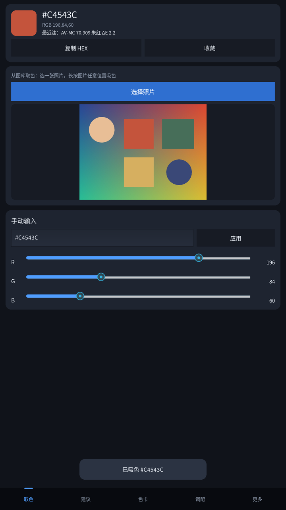
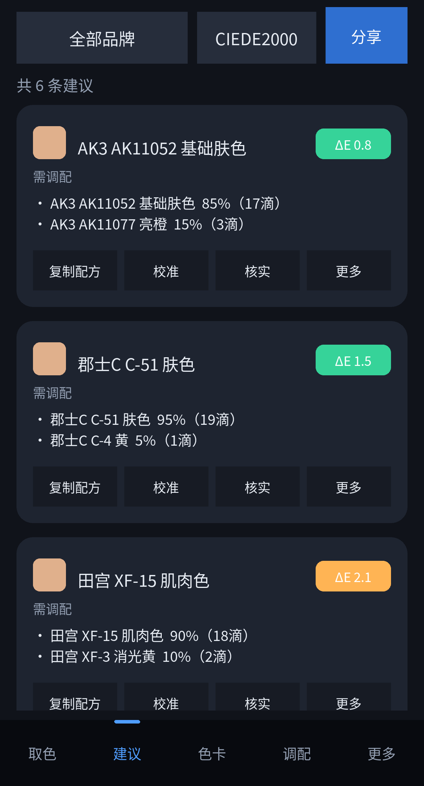
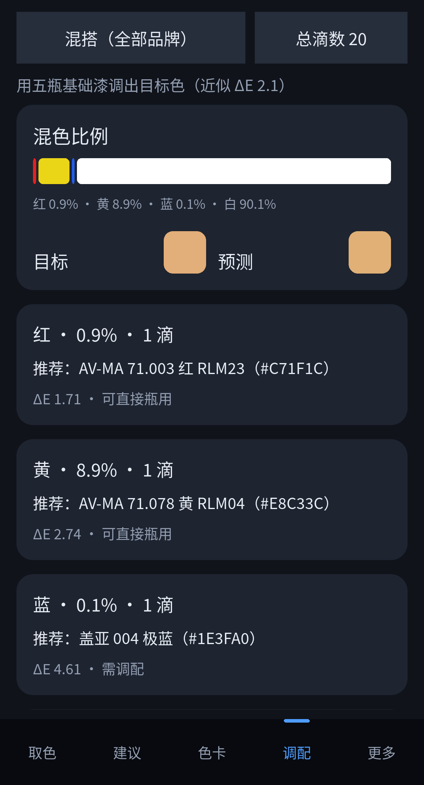

# ModelPaintPal · 安卓版

手办 / 模型涂装配色助手的 Android 版：**界面源码 + 安装包**都在这里。
屏幕取色、模型漆匹配、可执行滴数配方与用量估算。

桌面版（Windows）在另一个仓库：[regdiliKUN/ModelPaintPal](https://github.com/regdiliKUN/ModelPaintPal)。
配色匹配、配方计算、数据库这些**核心逻辑不在这里重复维护**，见下方「源码与构建」。

---

## 下载

**最新版 1.4.0**（2026-10-27）

[⬇ 直接下载 modelpaintpal-1.4.0-fullscreen-debug.apk](https://github.com/regdiliKUN/ModelPaintPal-APK/releases/download/v1.4.0/modelpaintpal-1.4.0-fullscreen-debug.apk) · 28.1 MB

仓库里也存了同一份：`apk/modelpaintpal-1.4.0-fullscreen-debug.apk`。历史版本见 [Releases](https://github.com/regdiliKUN/ModelPaintPal-APK/releases)。

## 安装

1. 把 APK 传到手机（或直接用手机打开本页下载）；
2. 点开文件，系统提示「未知来源应用」时允许安装；
3. 打开 App → 图库取色 → 选一张照片。

**只支持 `arm64-v8a`**（2018 年之后的主流机型都是）。老款 armeabi-v7a 机型装不上。

## 界面

| 取色（全屏） | 配色建议 | 调色配方 |
| --- | --- | --- |
|  |  |  |

更多截图见 `docs/screenshots/`。

## 源码与构建

```
.
├── mobile/            安卓端界面（Kivy）：screens / widgets / theme / photo 取色
├── main.py            buildozer 入口
├── buildozer.spec     打包配置（arm64-v8a，API 33）
├── scripts/
│   ├── sync_core.py   从桌面版仓库同步 app 核心层
│   └── run_tests.py   跑单元测试（结果写 test-report.txt）
├── apk/               当前最新安装包
└── docs/screenshots/  界面截图
```

核心层 `app/`（`core` / `data` / `services`）**不进版本库**：它属于桌面版，
每次构建前从桌面版仓库同步一份，避免两份代码各改各的。`app/ui`、`app/resources`
是 Qt 界面，打包时被 `buildozer.spec` 排除。

```bash
python scripts/sync_core.py      # 从同级目录的 ModelPaintPal 取核心层
python scripts/run_tests.py      # 54 项单元测试

pip install buildozer==1.6.0
buildozer android debug          # 产物在 bin/
```

`sync_core.py` 也支持 `--from <app 目录>` 和 `--from-git`（浅克隆桌面版仓库）。
CI（`.github/workflows/build-apk.yml`）就是先 checkout 桌面版仓库、同步核心层，再打包。

## 版本

| 版本 | 文件 | 主要改动 |
| --- | --- | --- |
| **1.4.0** | `modelpaintpal-1.4.0-fullscreen-debug.apk` | **取色改为全屏独立层**：选完照片进入铺满屏幕的取色界面，按住即取、拖动跟随、松手确认；6× 放大图 + 准星放在屏幕顶部，不会被自己的手指挡住。彻底修掉前几版一直存在的取色偏移。 |
| 1.3.0 | `modelpaintpal-1.3.0-pick-align-debug.apk` | 改用真实窗口坐标取样。桌面逐像素验证通过，真机仍有偏移，已被 1.4.0 取代。 |
| 1.2.0 | `modelpaintpal-1.2.0-pick-fix-debug.apk` | 按下即取样（不再要求长按 0.3 秒）；点在照片留白处不再报错，改为夹取最近边缘像素；照片下方新增放大预览条。 |
| 1.1.0 | `modelpaintpal-1.1.0-gallery-fix-debug.apk` | 修复「选完照片什么都不显示」——自建 Intent + ContentResolver 直接读图库字节。 |
| 1.1.0 | `modelpaintpal-1.1.0-ui-fix-debug.apk` | 修复界面被压扁、中文显示成方框。 |
| 1.1.0 | `modelpaintpal-1.1.0-arm64-v8a-debug.apk` | 首个能装上的版本（CI 原始产物）。 |

## 升级与签名

安装包用 debug 证书签名（自用分发，未上架应用商店）。**证书不同会报「应用未安装」，必须先卸载旧版。**

| 版本 | 证书 SHA-256（前 8 位） | 能否直接覆盖 |
| --- | --- | --- |
| 1.1.0-ui-fix / 1.2.0 / 1.3.0 / 1.4.0 | `fbfd75f0` | ✅ 互相覆盖，不用卸载 |
| 1.1.0-gallery-fix | `d271f1b3` | ❌ 先卸载 |
| 1.1.0-arm64-v8a | `b4b33bb3` | ❌ 先卸载 |

从 1.1.0-ui-fix 起签名已固定，**1.4.0 可以直接覆盖 1.2.0 / 1.3.0 安装**。

## 校验

```bash
sha256sum -c SHA256SUMS.txt
```

历史版本的完整校验值：

```
66ac4962378f6da08f5e87565bebebfbcf93316f3628ef54c1c5d5a09d6e0102  modelpaintpal-1.1.0-arm64-v8a-debug.apk
3c0365488811139e2a5543da39693fce74b207367246c564e3199d01040d26bc  modelpaintpal-1.1.0-ui-fix-debug.apk
e546e86b04938ba1d9e35a99861804b105c51f5c246adf254f0a5e8913abc9c8  modelpaintpal-1.1.0-gallery-fix-debug.apk
37df2914830fc9d15ed43e65cf40ec12c00bb6eba346237d31888eb59a2e0627  modelpaintpal-1.2.0-pick-fix-debug.apk
928c28d1573b91b755b876de4bb22a8fe42f8ddab3074f0fde35cdd0457298fc  modelpaintpal-1.3.0-pick-align-debug.apk
a545756935dcbb4c00c12ae3fa17398d63c2d062abab16abfeef38fc05f71d9c  modelpaintpal-1.4.0-fullscreen-debug.apk
```

## 发布新版本

1. 改 `buildozer.spec` 的 `version`，跑 `buildozer android debug`；
2. 把新包放进 `apk/`（删掉旧的），更新 `SHA256SUMS.txt` 和上面的版本表；
3. 打 tag 发 Release。
